# Проектирование программы учёта личных финансов

Целевая система обслуживает одного владельца и ведёт учёт рублёвых операций. Для расчёта используются только проведённые записи.

## 1.1 Классификация объектов предметной области

Чтобы восстановить остаток на любую дату, нужно отделить исходные сведения от событий и производных показателей. В таблице 2 приведены объекты, с которыми работает владелец.

**Объекты личного финансового учёта**

| Группа | Атрибуты | Связи и назначение |
| --- | --- | --- |
| Справочник счетов | Имя, дата начала учёта, начальный остаток | Один счёт содержит любое число операций. Пример — «Основной», 10 000 ₽ на 01.11.2026 |
| Справочник категорий | Уникальное название, вид дохода или расхода | Одна категория у многих операций. «Продукты» всегда относятся к расходам |
| Журнал операций | Дата, сумма, статус, версия, комментарий, ключ банка | Каждая запись относится ровно к одному счёту и одной категории |
| Результат расчёта | Границы периода, доход, расход, остаток, суммы по категориям | Сводка создаётся запросом к проведённым записям и не дублирует журнал |

Деньги хранятся в целых копейках. В журнале сумма положительна, а направление движения задаёт вид категории. Операция на 125 040 копеек в категории «Продукты» уменьшает остаток ровно на 1 250,40 ₽. Раздельное хранение суммы и направления исключает двойную смену знака.

Черновик позволяет сохранить запись до проверки. После проведения она участвует в расчётах. Аннулированная запись остаётся в журнале с прежним идентификатором, поэтому следующий импорт той же строки можно распознать.

## 1.2 Требования к информационной системе

Требования в таблице 3 связаны с наблюдаемым результатом. Исходное деление РР1 на ввод операций, редактирование и отчёты сохранено. Импорт уточнён как дополнительный способ пополнения журнала.

**Функции и условия приёмки**

| Код | Проблема и требование | Как проверить |
| --- | --- | --- |
| F1 | Ввести доход или расход с датой, категорией и комментарием | Нулевая сумма и дата до открытия счёта отклоняются. Сумма 0,01 ₽ допустима |
| F2 | Исправить или аннулировать ошибочную запись | Исправление одного расхода меняет оборот на разницу. Аннулирование сохраняет запись в истории |
| F3 | Найти операции счёта за период и получить отчёт | Ноябрь включает 30 ноября. Запись от 1 декабря видна в декабрьском отчёте |
| F4 | Загрузить банковскую выписку с предпросмотром | Повтор файла не меняет оборот. При конфликте ключа отклоняется весь пакет |
| N1 | Сохранить точность и согласованность | Суммы хранятся в копейках. Устаревшая версия записи отклоняется |
| N2 | Открыть отчёт без сети и без заметной задержки | На 10 000 записей от команды до показа сводки P95 ≤ 1 с на целевом ПК |
| N3 | Восстановить учёт после потери рабочего файла | Допустимая потеря по времени ≤ 24 ч, восстановление из копии ≤ 15 мин |

Выгрузку за месяц владелец сверяет с выпиской по конкретному счёту. Если выявлено расхождение, сначала проверяются дата начала учёта, начальный остаток и статусы. Такой порядок отделяет ошибку классификации от пропущенной операции.

## 1.3 Модель бизнес-процессов

Контекст IDEF0 (рисунок 1) задаёт границы учёта. Слева показан вход, сверху — правила, снизу — исполнитель и средства. Справа показаны результаты [4].

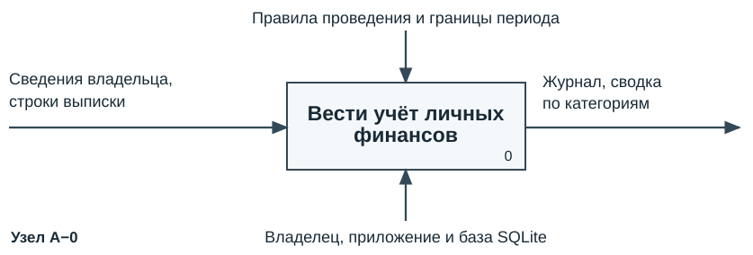

На рисунке 2 процесс показан в BPMN [5]. Дорожки разделяют действия владельца и программы. Исключающий шлюз возвращает неверную запись на исправление.

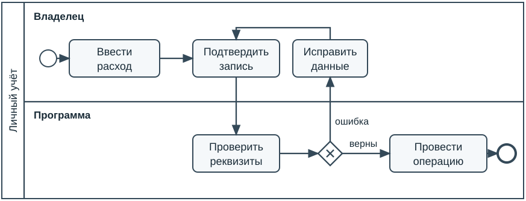

При сумме 0 ₽ программа возвращает форму. После исправления и подтверждения расход 1 250,40 ₽ попадает в сводку один раз.

## 1.4 Компоненты и рабочее место владельца

Задача архитектуры — провести одну и ту же проверку независимо от способа ввода. На UML-диаграмме компонентов (рисунок 3) пунктирная стрелка направлена от компонента к его зависимости [6].

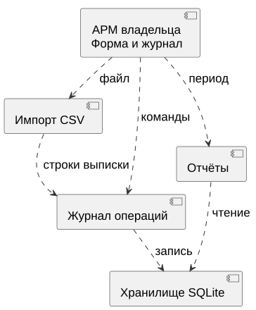

АРМ владельца объединяет форму операции, журнал и сводку. Форма передаёт команду журналу, а адаптер выписки передаёт ему подготовленные строки. Журнал проверяет дату, категорию и версию, затем фиксирует изменение в SQLite. Компонент отчётов читает только проведённые записи.

Отчёт строится после фиксации транзакции. Если подтверждение не состоялось, интерфейс сохраняет введённые поля и показывает причину. Разделение команд записи и запросов на чтение позволяет проверять расчёт независимо от вида экрана.

## 1.5 Логическая модель данных

Чтобы ограничить противоречия на уровне хранения, модель сведена к трём таблицам (рисунок 4). Знак «лапка вороны» показывает множество, кружок — допустимость нуля, двойная черта — ровно одну связанную запись. Ключ id однозначно определяет строку.

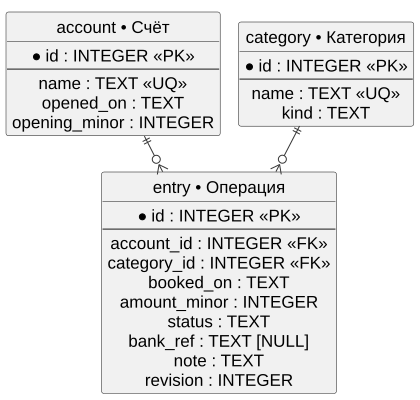

В entry поля account_id и category_id — обязательные внешние ключи. Проверка включается для каждого подключения командой PRAGMA foreign_keys = ON [11]. Вид категории постоянен, а ограничение на положительную целую сумму не позволяет записать отрицательный расход.

Пара (account_id, bank_ref) уникальна для записей с банковским ключом. У ручного ввода bank_ref пуст. Индекс по счёту, статусу и дате обслуживает выборку отчёта. Начальный остаток хранится в account, а конечный вычисляется. SQL-схема в репозитории позволяет повторить проверку ограничений.

## 1.6 Диаграмма классов

Диаграмма на рисунке 5 показывает распределение обязанностей. У объектов учёта есть устойчивые идентификаторы. Сервис отчётов опирается на текущие значения операций. Кратности у концов ассоциаций задают принадлежность записи счёту и категории [6].

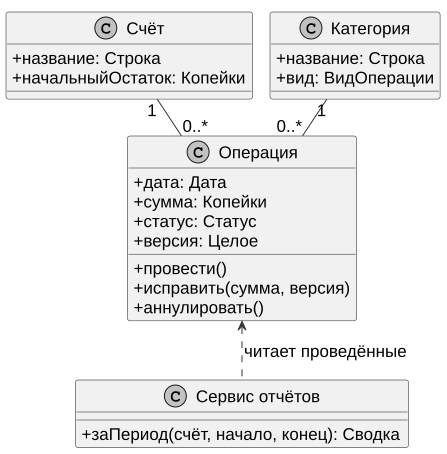

Метод проведения переводит черновик в учтённое состояние. Исправление принимает ожидаемую версию. Если два окна открыли запись версии 2, после сохранения из первого окна версия равна 3. Попытка сохранить старую сумму из второго окна вызывает предложение перечитать запись.

В исполняемой модели эти действия соответствуют функциям change_status и correct_amount. Сервис отчётов получает обороты через monthly. Такое соответствие позволяет проверять поведение классов на данных даже до сборки настольного интерфейса.

## 1.7 Диаграмма состояний операции

Для одной записи выделены три устойчивых состояния (рисунок 6). Запись появляется черновиком. Подтверждение допускается после проверки реквизитов. Внутреннее изменение полей сохраняет текущее состояние.

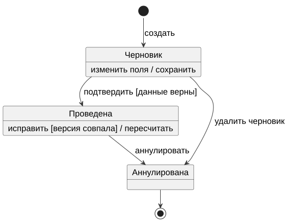

Удаление из пользовательского журнала реализуется аннулированием. Для черновика оно не затрагивает отчёт. Для проведённого расхода ранее учтённая сумма исключается из расходов и снова становится частью остатка. Аннулирование необратимо. Новое движение оформляется новой записью.

Контрольный расход на транспорт равен 149,60 ₽. После его аннулирования ноябрьские расходы снижаются с 1 400,00 до 1 250,40 ₽, а остаток увеличивается с 38 600,00 до 38 749,60 ₽. Модель запрещает повторное проведение аннулированной записи.

## 1.8 Риски проекта

Риски оценены по трёхбалльным шкалам вероятности и ущерба. Единица соответствует низкому уровню, тройка — высокому. Произведение определяет очерёдность мер. В таблице 4 указаны признаки, по которым ответственный запускает ответные действия.

**Реестр рисков разработки и внедрения**

| Риск | В × У | Мера и ответственный | Сигнал и действие |
| --- | --- | --- | --- |
| Повтор операции | 3 × 3 = 9 | Разработчик. Уникальность банковского ключа и сверка полей | Расхождение реквизитов — остановить импорт, показать строки |
| Потеря рабочего файла | 2 × 3 = 6 | Владелец. Ежедневная копия, еженедельное пробное открытие | Копия старше суток — сделать новую до обновления |
| Смена формата выписки | 3 × 2 = 6 | Разработчик. Явная схема и образец CSV | Неизвестный заголовок — отклонить файл, обновить адаптер |
| Ошибка классификации | 2 × 2 = 4 | Владелец. Предпросмотр и сравнение по категориям | Новая категория — запросить сопоставление до загрузки |
| Срыв срока пилота | 2 × 2 = 4 | Руководитель учебного проекта. Сначала журнал и отчёт | Срыв контрольной даты — отложить расширенные форматы |

Первый приоритет — повторная загрузка, поскольку она незаметно искажает финансовый итог. Даже после введения ключа остаётся риск совпадения ручного ввода и строки банка. При отсутствии общего идентификатора владелец сверяет дату и сумму, затем аннулирует один экземпляр. Автоматически объединять такие покупки опасно.

## 1.9 Сравнение моделей жизненного цикла

Для небольшого учебного проекта важны стоимость исправления ошибки, частота обратной связи и необходимость формального контроля. По этим основаниям сопоставлены четыре подхода в таблице 5.

**Сопоставление моделей жизненного цикла**

| Подход | Где появляется обратная связь | Последствие для проекта |
| --- | --- | --- |
| Каскадный | После завершения и передачи этапа | Удобен для фиксированной схемы отчёта. Ошибка в формате выписки обнаружится поздно |
| Итерационный | В конце каждого рабочего приращения | Можно сначала сверить ручной журнал, затем отдельно испытать импорт на тех же данных |
| Гибкий (Agile) | Короткие поставки и регулярная работа с пользователем [3] | Подходит для уточнения интерфейса. Для учебной приёмки нужны заранее записанные проверки |
| Спиральный | До нового витка оценивается главный риск | Оправдан при подключении банковского API. Для локального файла затраты на отдельный цикл велики |

Выбран итерационный цикл из трёх приращений. Первое закрывает ручной журнал и остаток. Второе добавляет исправления и аналитику. Третье проверяет CSV и восстановление. В конце каждой итерации владелец выполняет один законченный сценарий с известным результатом.

ИСР сохраняет набор работ и результаты. Порядок итераций определяет, когда их предъявлять. Например, тест сверки пишется уже для первого приращения и повторяется после изменения импорта.

## 1.10 Диаграммы взаимодействий

На рисунке 7 команда проведения передаёт ожидаемую версию. Альтернативный фрагмент показывает два исхода — подтверждение записи и конфликт версий.

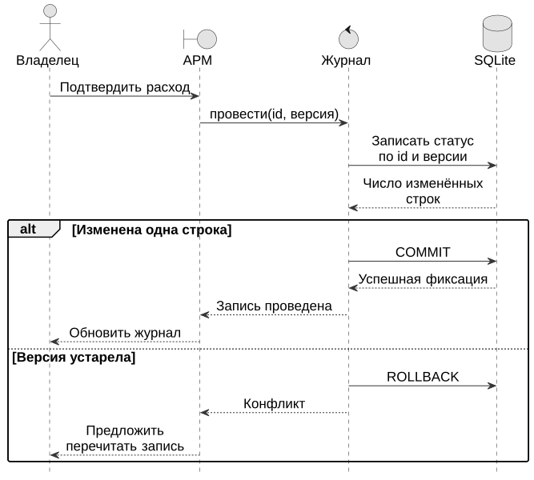

В первом исходе журнал получил подтверждение изменения одной строки. Интерфейс перечитывает запись и показывает статус «Проведена». Если соединение прервалось до фиксации, база сохраняет прежнее состояние.

Во втором исходе условие по версии не выполнено. Например, версия 2 уже сменилась версией 3 в другом окне. Журнал возвращает конфликт, интерфейс предлагает открыть актуальные данные. Повтор прежней команды здесь мог бы затереть более позднее изменение.

Для сводки по месяцу (рисунок 8) сервис читает и более ранние записи, чтобы перенести остаток. В обороты попадают только движения выбранного месяца.

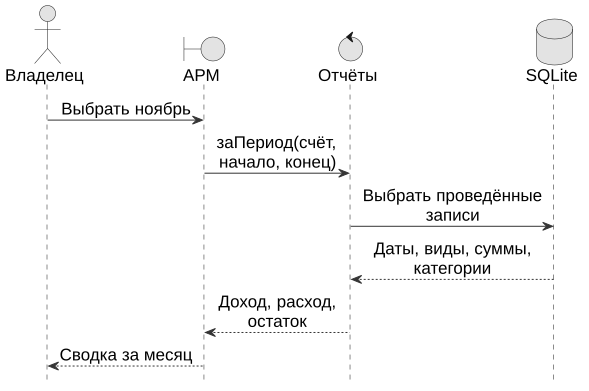

В контрольном наборе в выборку входят одна зарплата и два проведённых расхода. Сервис возвращает 30 000,00 ₽ дохода, 1 400,00 ₽ расхода и 38 600,00 ₽ остатка. Расходы по категориям составляют 1 250,40 ₽ на продукты и 149,60 ₽ на транспорт.

Если запросить декабрь без новых операций, обороты будут нулевыми. Остаток сохранит ноябрьское значение, поскольку сервис использует дату конца периода для остатка и обе границы периода для оборотов. Повторное чтение той же сводки оставляет журнал без изменений.

## 1.11 Диаграмма деятельности

Ключевой массовый процесс — импорт выписки. В отличие от ручного проведения одной операции здесь цена ошибки равна целому пакету. На рисунке 9 показаны проверка, развилки и условия окончания процесса.

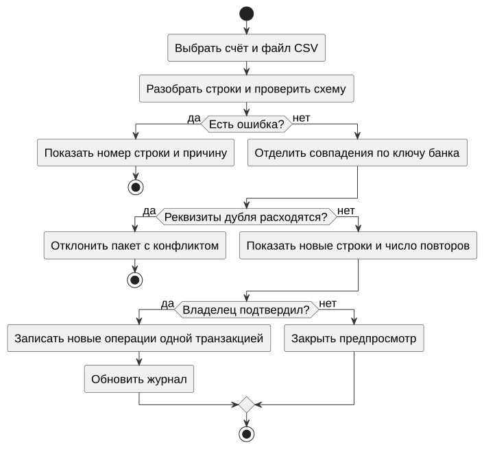

Если одна из строк содержит неверную дату, пакет отклоняется до записи. При совпадении банковского ключа сравниваются дата, категория и сумма. Полный повтор пропускается, расхождение останавливает пакет. Отмена в окне предпросмотра также сохраняет исходный журнал.

После подтверждения программа ещё раз сверяет ключи внутри транзакции. Поэтому две последовательно подтверждённые загрузки одного файла приводят к одной совокупности записей.

## 1.12 Пользовательский интерфейс

Главный экран отвечает на два вопроса владельца — сколько денег осталось и какие покупки образовали расход. На рисунке 10 показан интерактивный прототип с контрольным бюджетом ноября. Выбор месяца меняет обороты и конечный остаток отдельно.

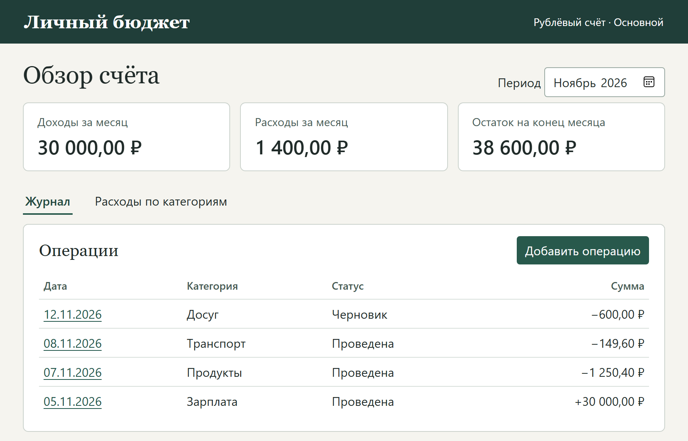

Вкладка «Расходы по категориям» показывает 1 250,40 ₽ на продукты и 149,60 ₽ на транспорт. Черновик на досуг виден в журнале. Это объясняет, почему сумма всех видимых строк расхода выше проведённых расходов на 600 ₽.

Прототип открывается локально из prototype/index.html. Можно выбрать месяц, добавить запись, открыть её по дате для исправления или аннулировать. Демонстрационные изменения действуют до перезагрузки страницы. Постоянное хранение и переходы состояний проверяются отдельно на модели SQLite.

При вводе суммы ошибка должна оставаться рядом с формой. Рисунок 11 показывает реакцию на 0 ₽. Поля доступны для исправления, а запись не появилась в журнале.

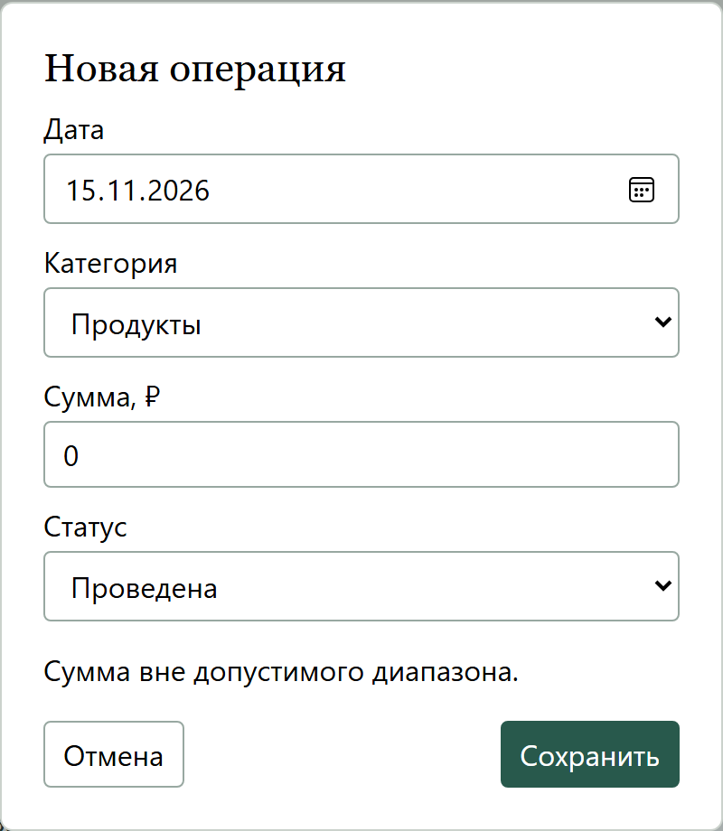

В сценарии приёмки владелец заменяет ноль на 230,10 ₽, выбирает категорию «Продукты» и сохраняет проведённую запись от 18 ноября. Журнал пополняется строкой, расход вырастает до 1 630,10 ₽, остаток снижается до 38 369,90 ₽. При сохранении черновика итоговые карточки не меняются.

Денежное значение отображается с двумя знаками после запятой. Текстовый статус различим при чёрно-белой печати. Поля формы имеют подписи, управление с клавиатуры сохраняется, а при отмене диалог закрывается без изменения сумм.

## 1.13 Требования к интеграции

Внешняя система для первого выпуска — программа банка или табличный редактор, из которого владелец передаёт нормализованную выписку. Обмен выполняется через локальный файл. Для чтения не нужны банковские учётные данные и сетевой протокол.

Профиль обмена использует CSV с разделителем-запятой, строкой заголовков и правилами кавычек по RFC 4180 [9]. Кодировка — UTF-8, даты — ГГГГ-ММ-ДД, суммы — положительные десятичные числа с точностью до копейки и точкой. Валюта всех строк — рубль. Таблица 6 задаёт порядок и смысл полей.

**Контракт одной строки импорта**

| Поле | Пример | Проверка |
| --- | --- | --- |
| bank_ref | B-008 | Непустой стабильный идентификатор в пределах выбранного счёта |
| booked_on | 2026-11-18 | Календарная дата не ранее начала учёта по счёту |
| kind | expense | income или expense, совпадает с видом категории |
| category | Продукты | Точное название существующей категории |
| amount | 230.10 | От 0,01 до 10 000 000 000,00 ₽ включительно, максимум два дробных знака |

Первый импорт B-008 добавляет одну запись. Повтор того же файла добавляет ноль. При сумме 231.10 с тем же ключом возвращаются номер строки и сообщение о конфликте. Выписку без устойчивого идентификатора владелец обрабатывает вручную. Такая граница делает результат повторной загрузки проверяемым.

## 1.14 Выбор технологии разработки

Технология должна работать на одном пользовательском ПК в отсутствие сети и сохранять данные между запусками. Сравнение в таблице 7 учитывает наличие Python-файлов в исходной структуре РР1 и стоимость сопровождения.

**Технологические варианты**

| Вариант | Преимущество для задачи | Ограничение |
| --- | --- | --- |
| Python, Tkinter, SQLite | Локальные формы, одна БД, стандартные интерфейсы Python [7], [8] | Нужны сборка для Windows и проверка комплектации Tcl/Tk |
| Веб-клиент, API, PostgreSQL | Совместная работа с разных устройств, централизованные копии | Нужны сервер, учётные записи и сопровождение сети |
| Электронная таблица | Быстрый ручной ввод и привычные фильтры | Контроль идентичности строк и атомарное проведение требуют дополнительной логики |

Выбран настольный стек Python, Tkinter и SQLite. Встроенная БД подходит для индивидуального локального приложения [10]. SQL-параметры отделяют текст запроса от значений, а транзакция фиксирует пакет целиком [7]. Код из первой работы уже предусматривал модули моделей и отчётов.

HTML-прототип служит для проверки экрана до сборки настольной версии. Выбор хранилища подтверждён исполняемой моделью. При появлении совместного доступа придётся пересмотреть владение данными, синхронизацию и способ разрешения конфликтов.

## 1.15 Стратегия тестирования

Результат проверяется на искусственном бюджете. Счёт открыт 1 ноября с 10 000,00 ₽. Зарплата 5 ноября — 30 000,00 ₽, продукты 7 ноября — 1 250,40 ₽, транспорт 8 ноября — 149,60 ₽, черновик на досуг 12 ноября — 600,00 ₽. Для каждого теста используется исходная копия набора.

**Контрольные сценарии и ожидаемые результаты**

| Код | Действие | Ожидаемый результат |
| --- | --- | --- |
| Т1 · F3 | Сформировать сводку за ноябрь | Доход 30 000 ₽, расход 1 400 ₽, остаток 38 600 ₽ |
| Т2 · F2 | Аннулировать транспорт. Отдельно исправить продукты до 1 200,40 ₽ | Остаток соответственно 38 749,60 ₽ и 38 650,00 ₽ |
| Т3 · F4 | Повторить файл. В другом запуске изменить сумму при том же ключе | Сумма при повторе прежняя. Конфликт не оставляет частичной записи |
| Т4 · F1, N1 | Ввести 0,01 ₽ и 0 ₽. Изменить запись с устаревшей версией | Копейка допустима, ноль отклонён. Старая версия не перезаписывает правку |
| Т5 · F3 | Провести расход 1 ₽ от 1 декабря | Ноябрь прежний, декабрьский остаток 38 599 ₽ |
| Т6 · N3 | Открыть восстановленную копию | Проверка целостности выдаёт ok, контрольные итоги совпадают |

В репозитории выполнены 11 модульных и интеграционных проверок. В браузере проверены переход к категориям, ошибка нулевой суммы, сохранение 230,10 ₽ и смена месяца. На приёмке будущей сборки дополнительно измеряются время полного показа окна, восстановление на отдельном ПК и длительность ввода владельцем.

## 1.16 Модель развёртывания

Целевая площадка — личный ПК под Windows 11 с 4 ГБ ОЗУ и 250 МБ свободного места как исходными условиями пилотной установки. На UML-диаграмме развёртывания (рисунок 12) показаны узлы, среда выполнения и размещённые артефакты.

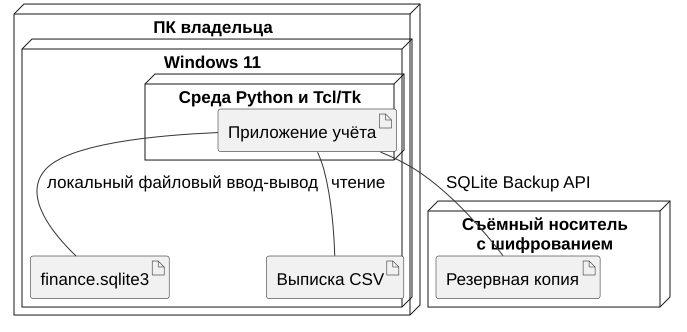

Сборка содержит интерпретатор, Tcl/Tk и модули приложения. Рабочая база и импортируемый файл доступны учётной записи владельца. Соединение с SQLite выполняется в процессе приложения. Для регистрации операций и формирования отчёта сервер и открытые сетевые порты не требуются.

Ежедневная копия создаётся через SQLite Backup API [12] на отдельном шифрованном носителе. Перед обновлением приложение создаёт дополнительную копию и проверяет её открытие. При восстановлении владелец открывает копию во временном каталоге, проверяет целостность и остаток, затем заменяет рабочий файл при закрытом приложении.

## 1.17 Требования к безопасности

Защищаемые данные — суммы, даты, категории и комментарии владельца. Границы доверия проходят между файлом выписки и импортом, а также между каталогом БД и другими пользователями ПК. Для этих границ предусмотрены меры из таблицы 9.

**Угрозы и проверка мер защиты**

| Угроза | Мера | Проверка |
| --- | --- | --- |
| Чтение чужим пользователем ПК | Каталог профиля с правами владельца, защита диска средствами ОС | Из обычной второй учётной записи БД недоступна |
| Утрата ПК или носителя | Шифрование диска и съёмного носителя, ключ восстановления хранится отдельно | Заблокированный носитель требует ключ |
| Некорректная выписка | Явная схема, ограничения данных, параметры SQL, отмена пакета при ошибке | Тест с неверной датой и конфликтом ключа не меняет журнал |
| Раскрытие сведений через диагностику | В журнал диагностики писать код ошибки и номер строки, исключить суммы и комментарии | Проверить диагностический файл после ошибки |
| Повреждение или случайное удаление | Согласованная ежедневная копия и еженедельная проверка восстановления | Сверить число операций и итог с контрольной копией |

В Git публикуются схемы, код и учебный набор данных. Выписки, рабочая БД и её копии исключены из состава проекта. Локальная защита предполагает исправную операционную систему. При компрометации учётной записи доступ к открытой базе остаётся существенным остаточным риском.

## 1.18 Метрики эффективности

После внедрения качество оценивается по данным владельца и измерениям на его ПК. В таблице 10 заданы цели пилота, исходные данные и период наблюдения.

**Показатели пилотной эксплуатации**

| Метрика и цель | Способ измерения | Когда и кто проверяет |
| --- | --- | --- |
| Расхождение остатка — 0,00 ₽ | Модуль разности между итогом журнала и выпиской на одну дату при равных начальных условиях | Владелец в конце каждого месяца |
| Повторы импорта — 0 новых записей | Сравнить число записей и расход до и после повторной загрузки файла | Разработчик при каждом выпуске |
| P95 открытия сводки ≤ 1 с | От выбора месяца до отображения результата. 30 запусков по 10 000 записей, 29-е значение отсортированного ряда | Разработчик на пилотном ПК |
| Медиана ввода ≤ 30 с | От открытия формы до подтверждения. Десять однотипных ручных операций за сессию | Владелец в конце первой недели |
| Возраст копии ≤ 24 ч, возврат к работе ≤ 15 мин | Проверить метку последней копии и засечь восстановление до сверенного отчёта | Владелец еженедельно |

Предварительный замер проверяет только расчёт в памяти. На Ryzen 5 5560U, Python 3.12.14 и SQLite 3.53.1 для 10 000 записей после одного прогрева получены медиана 22,08 мс и P95 28,83 мс за 30 запусков. Эта величина оставляет запас на вывод окна. Показатель полного интерфейса измеряется отдельно на целевой сборке.

## 1.19 Техническое задание и документация

Сокращённое техническое задание построено по разделам ГОСТ 19.201-78 [1]. Наименование разработки — «Программа учёта и анализа личных финансов». Основание — индивидуальное задание РР2 по варианту «П» и требования РР1. Назначение — ведение рублёвого журнала одним владельцем и получение сверяемого отчёта.

Требования к программе и условиям эксплуатации. Выпуск должен обеспечить F1–F4 и N1–N3 из таблицы 3. Рабочая станция, носитель и хранение описаны в подразделе 1.16. Формат входа задаёт таблица 6. Результат работы — журнал и месячная сводка на экране. В поставку входят настольное приложение, описание формата, инструкция по копированию и контрольный набор.

Требования к документации. В репозитории README содержит запуск, docs/design.md — архитектуру, docs/schema.sql — ограничения данных. Исходники моделей расположены в docs/diagrams. Прототип формы и тесты служат приложениями к описанию. Правило расчёта закреплено за модулем src/reports.py.

Технико-экономический показатель — время ежемесячной сверки. На пилоте владелец фиксирует исходное время в таблице и время того же сценария в приложении. Цель — сократить медиану не менее чем на 20 % по трём сопоставимым периодам. Стадии и исполнители заданы планом внедрения.

Порядок контроля и приёмки. Разработчик воспроизводит Т1–Т6 из таблицы 8 на чистой установке. Владелец сверяет остаток 38 600,00 ₽ и читает восстановленную копию. Решение о приёмке оформляется после устранения расхождений, проверки N2 и N3 и передачи инструкции. Учебная модель уже подтверждает расчётный и транзакционный контур.

## 1.20 План внедрения

Внедрение начинается с копии контрольного набора, затем переходит к одному счёту владельца. Плановые сроки в таблице 11 отсчитываются от согласования прототипа. Ответственные указаны по проектным ролям.

**План пилотного внедрения**

| Срок и этап | Исполнитель и работа | Условие перехода и действие при сбое |
| --- | --- | --- |
| Дни 1–2. Подготовка | Разработчик собирает версию, владелец подтверждает справочники | Контрольная сводка 38 600 ₽. При расхождении исправить модель и повторить Т1 |
| День 3. Установка | Разработчик ставит сборку на ПК, владелец выбирает защищённый каталог | Демонстрационный журнал читается без сети. При проблеме восстановить предыдущую сборку |
| Дни 4–7. Пилот | Владелец параллельно ведёт прежнюю таблицу и один счёт в программе | На одну дату разность 0,00 ₽. Расхождения расследовать до переноса остальных данных |
| День 8. Приёмка | Разработчик проверяет время сводки, владелец восстанавливает копию | N2 и N3 достигнуты, замечания закрыты. Иначе продлить пилот |
| Дни 9–14. Сопровождение | Владелец сверяет журнал, разработчик разбирает зарегистрированные сбои | Ежедневные копии, повторная сверка и фиксация версии после исправлений |

При откате перед заменой рабочей базы сохраняется отдельная копия текущих данных. Операции после точки восстановления владелец сверяет с выпиской и вводит заново при необходимости. Переход к постоянному использованию зависит от контрольного остатка и первого успешного восстановления.

## 1.21 Сравнение методов проектирования

Для выбора метода важно понять, какая ошибка дороже на каждом уровне. Потерю шага в процессе лучше выявляет функциональное разложение, а несогласованный переход состояния — объектная модель. Таблица 12 сравнивает результаты для одной операции.

**Методы проектирования на примере расхода**

| Метод | Что удаётся проверить | Ограничение и применение |
| --- | --- | --- |
| Структурный | IDEF0 показывает вход, правила и результат. BPMN закрепляет исполнителя и возврат на исправление | Не задаёт сам по себе допустимые переходы конкретной записи. Используется для согласования процесса с владельцем |
| Объектно-ориентированный | UML связывает операцию, категорию, счёт и действия над записью. Версия и статус задают условия изменения | Требует отдельного обзора потока работы. Используется для проектирования модулей и тестов |
| Моделирование данных | ER-схема задаёт обязательные связи, уникальный ключ банка и тип суммы | Хорошо выявляет дубли, но не показывает последовательность исправления. Дополняет обе модели |

Ведущим выбран объектно-ориентированный метод. Если изменить правило аннулирования, можно проследить последствия от диаграммы состояний до команды журнала, SQL-ограничения и теста Т2. На этапе согласования границ используются IDEF0 и BPMN, а долговременные инварианты передаются в реляционную схему.

Такое сочетание даёт проверяемый критерий полноты. Для каждого изменения суммы должны существовать пользовательское действие, допустимый переход и однозначное последствие в сводке.

## Заключение

Спроектирована программа личного учёта, в которой владелец может объяснить конечный остаток по отдельным проведённым операциям. Границы версии, роли и восемь этапов ИСР сохранены из первой работы. Из программной части исключены операции, для которых потребовались бы доступ к банковскому счёту или пересчёт валют.

Классификация выделила справочники, события и вычисляемые результаты. Требования задали точность до копейки, границы расчётного месяца и условия восстановления. В IDEF0 зафиксированы входы и выходы, в BPMN — действия владельца при ошибке ввода. Компонентная модель закрепила запись за журналом, расчёт — за сервисом отчётов.

ER-схема связывает каждую запись с одним счётом и категорией. Диаграмма классов определяет обязанности объектов, а диаграмма состояний объясняет, почему черновик на 600 ₽ не меняет итог. В проверенном наборе остаток равен 38 600 ₽. Аннулирование проведённого расхода на 149,60 ₽ повышает его до 38 749,60 ₽.

Повторный импорт и потеря базы получили первоочередные меры в реестре рисков. Итерационный цикл даёт возможность сверить журнал до подключения выписок. Диаграммы последовательности раскрыли конфликт версий и чтение отчёта, диаграмма деятельности — атомарную загрузку пакета. На интерактивном прототипе проверены выбор месяца, категории и реакция формы на нулевую сумму.

Файловый контракт CSV обеспечивает обмен без передачи банковских учётных данных. Выбран локальный стек Python, Tkinter и SQLite. Все 11 автоматических проверок исполняемой модели пройдены, включая восстановление и повтор импорта. Развёртывание на одном ПК задаёт понятную границу доступа. Защита базы дополняется отдельной резервной копией и ограничением состава диагностических данных.

Метрики связывают качество с точной сверкой, скоростью ввода и временем восстановления. Предварительный P95 вычисления сводки на 10 000 строк составил 28,83 мс. До приёмки предстоит измерить полное открытие окна и время восстановления на компьютере владельца.

Техническое задание связывает функции с контрольным набором и условиями поставки. План внедрения предусматривает параллельный учёт и возврат к резервной копии при расхождении. Объектно-ориентированный метод выбран основным, поскольку он связывает действие пользователя, состояние записи и итог отчёта. Структурные схемы и модель данных дают независимые способы проверить тот же результат.

## Источники

1. ГОСТ 19.201-78. Единая система программной документации. Техническое задание. Требования к содержанию и оформлению. Росстандарт. [Источник](https://protect.gost.ru/gost/details/b64061cf-6bb2-4c75-aee9-18bb5e26e554)

2. Рейтинговая работа № 1 по дисциплине «Проектная деятельность в ИТ». Разделы 2–3. Материалы проекта, 2026.

3. Основополагающие принципы Agile-манифеста. Авторы Agile Manifesto. [Источник](https://agilemanifesto.org/iso/ru/principles.html)

4. Integration Definition for Function Modeling (IDEF0). FIPS PUB 183. National Institute of Standards and Technology, 1993. [Источник](https://nvlpubs.nist.gov/nistpubs/Legacy/FIPS/fipspub183.pdf)

5. Business Process Model and Notation. Version 2.0.2. Object Management Group, 2014. [Источник](https://www.omg.org/spec/BPMN/2.0.2/)

6. Unified Modeling Language. Version 2.5.1. Object Management Group, 2017. [Источник](https://www.omg.org/spec/UML/2.5.1/)

7. sqlite3 — DB-API 2.0 interface for SQLite databases. Python Software Foundation. Python 3 Documentation. [Источник](https://docs.python.org/3/library/sqlite3.html)

8. tkinter — Python interface to Tcl/Tk. Python Software Foundation. Python 3 Documentation. [Источник](https://docs.python.org/3/library/tkinter.html)

9. Shafranovich Y. Common Format and MIME Type for Comma-Separated Values (CSV) Files. RFC 4180. RFC Editor, 2005. [Источник](https://www.rfc-editor.org/rfc/rfc4180)

10. Appropriate Uses For SQLite. SQLite Documentation. [Источник](https://www.sqlite.org/whentouse.html)

11. SQLite Foreign Key Support. SQLite Documentation. [Источник](https://www.sqlite.org/foreignkeys.html)

12. SQLite Online Backup API. SQLite Documentation. [Источник](https://www.sqlite.org/backup.html)
